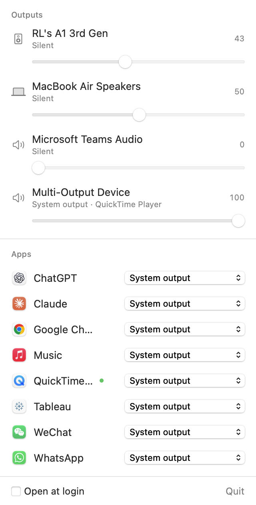

# SoundSplit

Play different apps on different speakers at the same time. Music on the Bluetooth speaker, a call on the MacBook. Free and open source.



SoundSplit lives in the menu bar. For each app that makes sound, pick an output. Each output has its own volume slider.

## Install

1. Download `SoundSplit.zip` from [Releases](https://github.com/ryandril/soundsplit/releases) and unzip it.
2. Drag **SoundSplit.app** into **Applications**.
3. The app isn't notarized by Apple (that needs a paid developer account), so the first open is blocked. Open it once, then go to **System Settings › Privacy & Security** and click **Open Anyway**.
4. The first time you move an app, macOS asks for **System Audio Recording** access. Allow it — SoundSplit needs it to pick up an app's sound and play it somewhere else. Nothing is recorded or saved.

Requires macOS 14.4 or later, Apple silicon. On an Intel Mac, build from source.

## How it works

- **System output** — the app plays wherever macOS sends sound (the output picked in Control Center).
- **A specific device** — SoundSplit mutes the app at the source and plays its sound on that device instead.
- Choices are remembered by app. If the device is off, the app falls back to the system output until it comes back.
- Volume sliders change the device's own volume. Outputs without one (HDMI, some USB) get a software volume for the apps sent there.
- Quitting SoundSplit puts every app back on the system output.

Under the hood it uses Core Audio [process taps](https://developer.apple.com/documentation/coreaudio/capturing-system-audio-with-core-audio-taps) (macOS 14.4+): a tap captures the chosen apps and mutes their normal output, and a private aggregate device plays that audio on the target device. No virtual audio driver, nothing to install system-wide.

**Tip:** if you use a Multi-Output Device to play everything on two speakers, switch the system output back to one real device. Then send only the apps you want to the other one.

## Build from source

Needs the Xcode Command Line Tools (`xcode-select --install`).

```bash
./scripts/build-app.sh      # makes build/SoundSplit.app and build/SoundSplit.zip
open build/SoundSplit.app
```

Each local build is ad-hoc signed, so macOS treats it as a new app and asks for audio access again.

`swift scripts/make-icon.swift` regenerates the app icon.

## License

MIT
